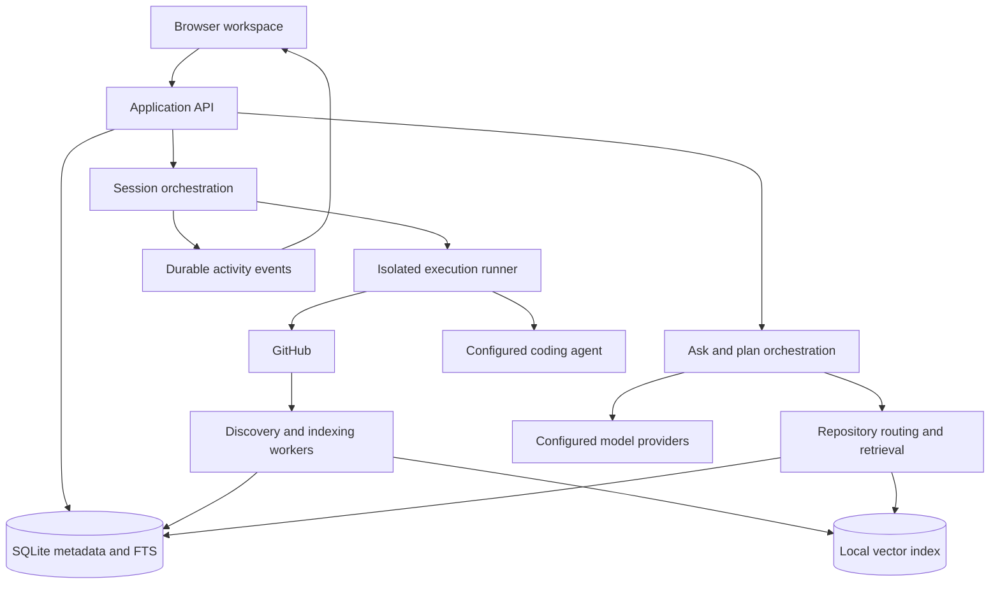

# OpenDevin — Master Product Requirements Document

Status: Draft for product and engineering review

Version: 0.1

Date: 2026-11-13

Product name: OpenDevin (requested working name)

Repository: currently `repo-ask`; Python package: currently `repoask`

## 1. Product vision

OpenDevin is an open-source, self-hosted engineering workspace that turns a prompt into a repository-aware plan and an observable implementation session. A user connects GitHub once, asks for work across their repositories, reviews a plan in Ask mode, and starts a session that prepares a workspace, implements changes, validates them, and opens pull requests.

The primary experience must remove the repeated work of finding a repository, cloning it, opening a coding agent, and rebuilding context. Users retain control over repository scope, model providers, execution, and retained knowledge.

## 2. Problem and primary user

The initial user is an individual developer maintaining more than 200 personal and organization repositories. They may know a product or feature name without remembering its repository. Related functionality may span a frontend, service, schema repository, and worker. Existing manual setup makes small tasks expensive and loses context between sessions.

Primary jobs:

- Find where a feature lives using a natural-language description.
- Understand current behavior with source evidence.
- Produce an implementation-ready plan before changing code.
- Launch and supervise an agent without manually preparing a checkout.
- Review tested changes through GitHub PRs.
- Bring preferred models, reusable skills, tools, and durable memory.

Teams and multi-user enterprise deployments are later audiences. The initial release must not imply that a loopback single-user application already provides multi-tenant isolation.

## 3. Current baseline and proposed scope

Verified from the checked-in source on the document date:

| Area | Current prototype | Target behavior |
| --- | --- | --- |
| Repository source | Up to eight explicit local checkouts or bundled fixtures | Paginated GitHub discovery for 200+ repositories |
| Index | In-memory SQLite FTS over committed snapshots | Persistent metadata, full-text and vector retrieval, background jobs |
| Answers | Literal retrieval plus optional loopback Ollama | Configurable providers and cited planning conversations |
| Plans | No durable plan object | Editable, versioned plans with launch validation |
| Execution | Read-only | Isolated asynchronous coding sessions |
| GitHub writes | None | Branch push and explicit draft PR publication |
| Customization | No user-facing management | Versioned skills, plugins, and scoped memory |
| UI | Local repository picker, results and source pane | Ask, Sessions, Repositories, customization and Settings |

This document specifies future work. It does not represent shipped capabilities. Existing file and byte caps are prototype limits, not requirements for the new product.

## 4. Core journey

1. Start the local application and connect GitHub through a GitHub App installation.
2. Select repositories eligible for indexing and separately enable implementation access.
3. Return to Ask while discovery and indexing run in the background.
4. Enter a request such as “Add retry handling to the order email worker.”
5. Receive likely repositories, reasons, index freshness, and cited findings. Resolve ambiguity when needed.
6. Refine and save a structured implementation plan in Ask mode.
7. Choose **Start session**, reviewing the plan version, repositories, execution profile and limits inline.
8. Follow provisioning, edits, commands, tests and diffs in Sessions; send follow-ups or stop work.
9. Inspect the outcome and choose **Open draft PR** unless publication was explicitly enabled at launch.
10. Review the PR on GitHub; retain useful knowledge through inspectable memory.

Ask never executes repository commands or applies code changes. Starting a session authorizes work within its recorded scope. Publication authorization is recorded separately; no automatic merge is included.

## 5. Product principles

- Repository selection must be explainable and overridable.
- Claims about existing code must cite an indexed commit, file and line range.
- Planning and implementation are separate durable objects with explicit handoff.
- Every running session must have visible state, bounded resources and a stop action.
- Background work must survive restarts without silently duplicating external effects.
- Local storage does not imply local inference: show when source leaves the machine.
- Skills, plugins, repository content and memory cannot grant themselves permissions.
- Prefer incremental repository context over repeatedly sending entire repositories to models.

## 6. Scope and delivery milestones

| Milestone | Outcome | Included features | Exit gate |
| --- | --- | --- | --- |
| M0: Foundation | Durable local workspace | SQLite migrations, job queue, secret references, navigation skeleton | Restart preserves records; current demo still works |
| M1: Connected Ask | Find repositories and produce plans | GitHub discovery, progressive hybrid indexing, routing, provider profiles, Ask and plan versions | 250-repository discovery fixture; cited routing and plan evaluation pass |
| M2: Implementation MVP | Prompt → plan → session → draft PR | One execution adapter, isolated containers, event stream, diffs, tests, PR publication | Representative task completes end to end with recovery and cancellation checks |
| M3: Customization | Reusable user-owned behavior | Skills, approved plugins/MCP, scoped memory management | Version pinning, permission boundaries and deletion tests pass |
| M4: Expansion | Broader deployment and execution choices | Additional coding-agent adapters, richer cross-repo execution, optional webhooks | Separate scope review and release criteria |

M2 is the first end-to-end MVP. M1 is a usable planning release. M3 is part of the product commitment, not a prerequisite to delivering M2. Minimal built-in instructions and per-session context exist before user-managed customization.

## 7. Feature specifications

| ID | Specification | Primary milestone | Depends on |
| --- | --- | --- | --- |
| F01 | [GitHub connection and discovery](docs/features/01-github-connection.md) | M1 | F12 foundation |
| F02 | [Repository context and hybrid retrieval](docs/features/02-repository-indexing.md) | M1 | F01, F07, F12 |
| F03 | [Repository routing](docs/features/03-repository-routing.md) | M1 | F02 |
| F04 | [Ask mode and implementation plans](docs/features/04-ask-and-planning.md) | M1 | F03, F07 |
| F05 | [Implementation sessions](docs/features/05-implementation-sessions.md) | M2 | F04, F07, F12 |
| F06 | [GitHub pull requests](docs/features/06-pull-requests.md) | M2 | F01, F05 |
| F07 | [AI providers and execution adapters](docs/features/07-providers-and-agents.md) | M1–M2 | F12 foundation |
| F08 | [Skills management](docs/features/08-skills.md) | M3 | F04, F05 |
| F09 | [Plugins and tool integrations](docs/features/09-plugins.md) | M3 | F05, F12 |
| F10 | [Memory management](docs/features/10-memory.md) | M3 | F02, F04, F05 |
| F11 | [Workspace experience](docs/features/11-workspace-experience.md) | M0–M3 | Delivered alongside each feature |
| F12 | [Persistence, jobs and operations](docs/features/12-platform-operations.md) | M0 onward | Foundational |

Dependencies apply to usable slices, not completion of an entire specification. F07 can provide embeddings before agent execution; F12 evolves through all milestones.

## 8. Logical architecture

Implementation direction: retain Python initially, extract API and worker responsibilities from the current prototype, and use a durable SQLite-backed job queue for a single-host deployment. Framework, vector extension and frontend library choices require an implementation spike; this PRD does not mandate an unverified dependency.

Use a bounded local repository cache and a separate workspace per session. Start with container-based execution and one supported agent adapter. A host checkout alone is not an isolation boundary. No repository installation scripts execute during indexing.

## 9. Shared data and interface conventions

All durable entities have stable IDs and timestamps. Repository identity uses GitHub's repository ID, not its mutable display name. Plans and sessions retain repository-specific commit SHAs. Secrets are stored outside normal records and referenced by ID.

Core entities: Workspace, GitHubConnection, Repository, RepositorySnapshot, IndexJob, CodeChunk, EmbeddingNamespace, Conversation, Message, Plan, PlanVersion, Session, SessionRepository, SessionEvent, ValidationRun, PullRequest, ProviderProfile, ExecutionProfile, SkillVersion, PluginVersion, Memory and AuditEvent.

Logical `/api/...` routes in feature documents are proposed application contracts, not existing routes. State-changing requests require local origin/session protections and validation. Long operations return durable IDs. Start, push and publish operations use idempotency keys. List routes paginate. Event replay uses a session-local monotonically increasing sequence number.

## 10. Cross-cutting requirements

- **Scale:** discover and catalog at least 250 accessible repositories without the prototype's eight-repository limit. All codebases need not be loaded into memory together.
- **Availability:** cached Ask remains usable during indexing and GitHub outages, subject to access revocation and freshness rules.
- **Consistency:** a citation always resolves to its recorded snapshot; a session never silently substitutes another plan or base commit.
- **Privacy:** index only eligible source; exclude credentials, generated artifacts and configured paths; redact diagnostic output. Explicitly disclose external inference and embedding destinations.
- **Execution:** per-session filesystem and process isolation, bounded network policy, timeouts and resource limits; no unrestricted host shell.
- **Recovery:** recover queued work after restart; mark interrupted execution accurately; reconcile unknown push/PR outcomes before retrying.
- **Accessibility:** keyboard navigation, visible focus, labeled controls, readable contrast and non-color state indicators.
- **Licensing:** retain the repository's MIT license and document dependency licenses before distribution. Product naming does not rename or remove upstream license attribution.

## 11. Proposed success measures and release gates

These are initial targets to validate, not measured performance claims.

| Measure | Target and measurement |
| --- | --- |
| Repository coverage | All accessible, selected records discovered in a paginated 250-repository fixture; exclusions visible |
| Routing | Correct repository appears in top three for ≥90% of 50 labeled, answerable tasks across a 250-repository catalog; ambiguous and absent tasks evaluated separately |
| Evidence integrity | 100% of rendered source citations resolve to stored commit/path/line ranges; factual support reviewed on 30 representative plans |
| Planning usability | At least 8 of 10 pilot tasks produce a plan requiring no repository reselection and no major missing requirement |
| End-to-end execution | At least 8 of 10 bounded benchmark tasks reach a reviewable draft PR with recorded checks; failures remain inspectable |
| Recovery | No duplicate sessions or PRs in timeout, retry and application-restart acceptance scenarios |
| Responsiveness | Cached catalog reads p95 <1 second; cached routing excluding model time p95 <2 seconds on the reference fixture |
| Stop behavior | Stop acknowledged within 2 seconds locally; runner terminates or reports containment failure within 10 seconds |

Reference performance fixture: 250 repository metadata records, 25 code-indexed repositories, up to 100,000 eligible chunks, SSD, 8 logical CPU cores, 16 GiB RAM. Record cold/warm results separately and report model, network, clone and container startup times separately. Adjust chunk budget after the M1 spike, with the change recorded here.

## 12. Non-goals for the initial release

- Training a foundation model or building a new coding agent from scratch.
- Automatically modifying every discovered repository.
- Autonomous merging, production deployments or arbitrary account administration.
- Enterprise SSO, multi-tenant hosting, organization billing or mobile applications.
- Fully indexing every branch or all Git history.
- Atomic transactions across pull requests in multiple repositories.

## 13. Risks, decisions and open questions

| Topic | Working decision | Remaining question / validation |
| --- | --- | --- |
| Name | Use OpenDevin in new product documents | Existing OpenDevin/OpenHands name history requires public naming review |
| GitHub authentication | GitHub App with selected installations/repositories | Validate practical local installation and callback setup |
| Deployment | Single-user, self-hosted, loopback-first | Remote deployment requires authentication and TLS design |
| Database | SQLite metadata and FTS plus local vectors | Select vector engine after compatibility, licensing and benchmark spike |
| Execution | Container runner and one agent adapter for M2 | Select first adapter by headless support, authentication and cancellation tests |
| External AI | Bring-your-own providers and credentials | Choose pilot defaults; no paid provider assumed configured |
| Index cost | Metadata first, bounded deep indexing | Calibrate budgets and repository prioritization with the user's catalog |
| Cross-repository tasks | Plan multiple repos; M2 executes one writable repo per session | Define coordinated multi-repository execution in M4 |
| Memory | User-visible, provenance-backed, scoped | Validate proposal quality before enabling inferred memory by default |

Planning can describe a cross-repository change before coordinated execution exists. M2 must clearly identify unsupported multi-repository execution and offer separate linked plans; it must not launch a partial plan as if all repositories were included.

## 14. Definition of done and change control

A milestone is complete when its feature acceptance scenarios pass, user-visible behavior matches the documented scope, operational failures are inspectable, and setup/recovery instructions are available. M2 additionally requires one real GitHub-connected pilot using disposable test repositories, explicit publication, and a PR containing actual changes and validation results.

Every feature spec defines boundaries, requirements, data/contracts, failure behavior and acceptance criteria. Requirement IDs remain stable. Material decisions, scope changes and measured target revisions update this master and the owning feature spec in the same change.

The technical identifier `repoask`, current CLI and existing README run instructions remain valid until an explicit migration is implemented. Creating these PRDs does not perform that migration.
